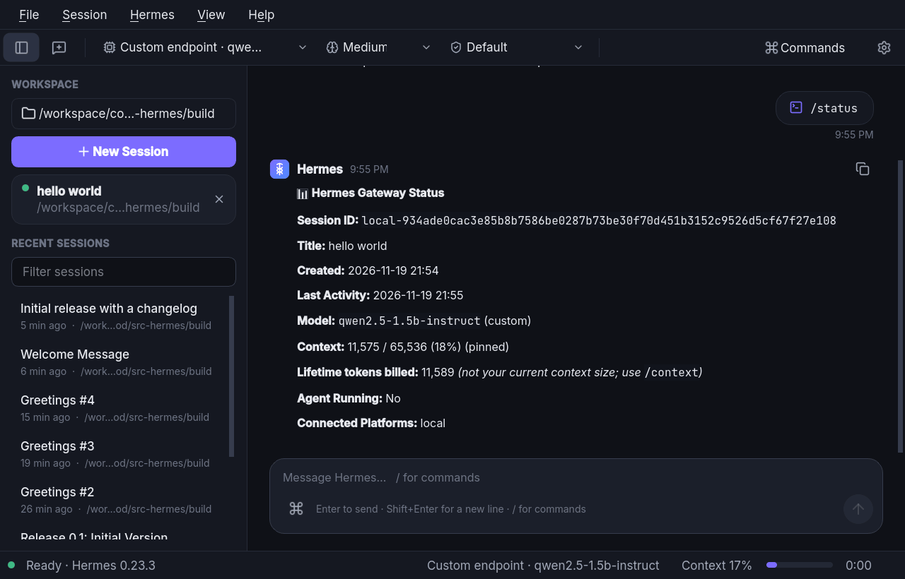
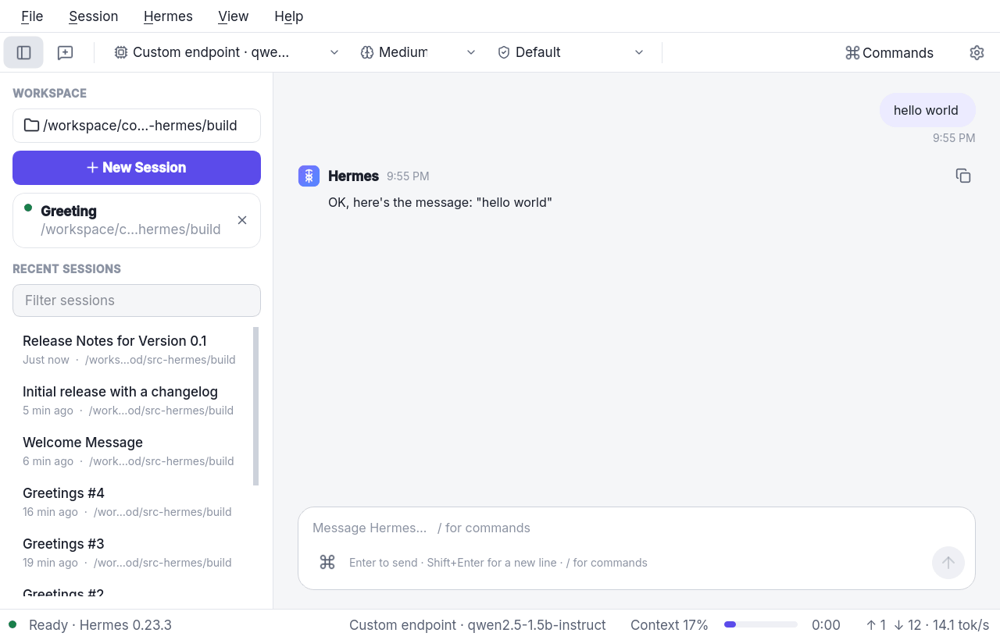
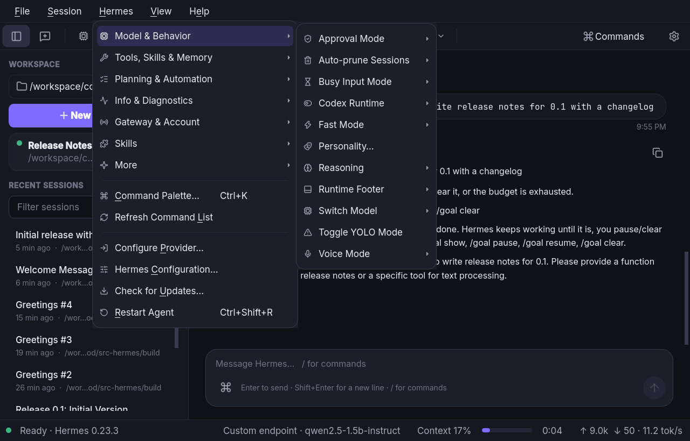
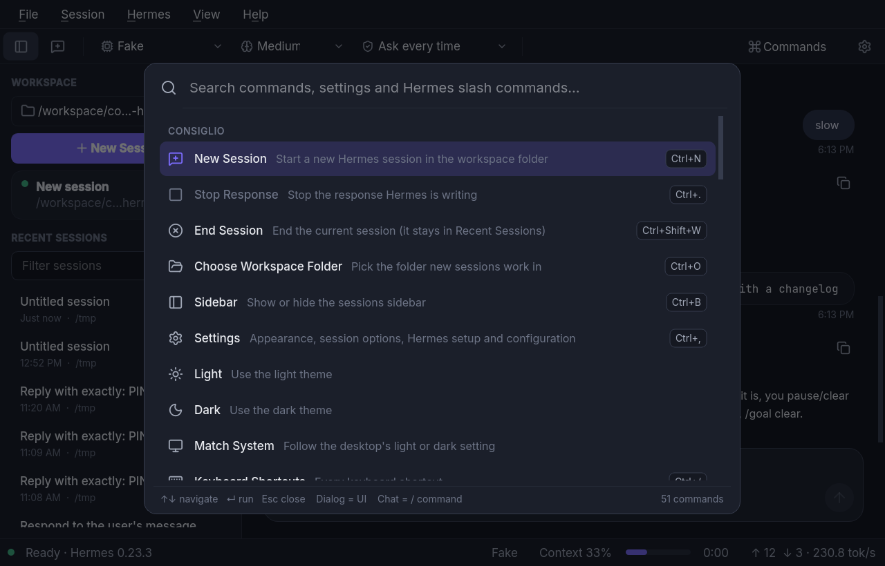
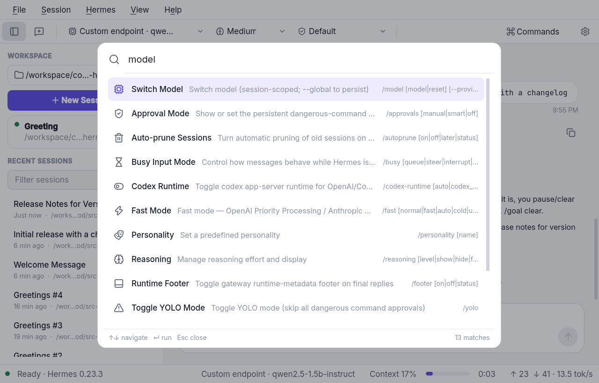
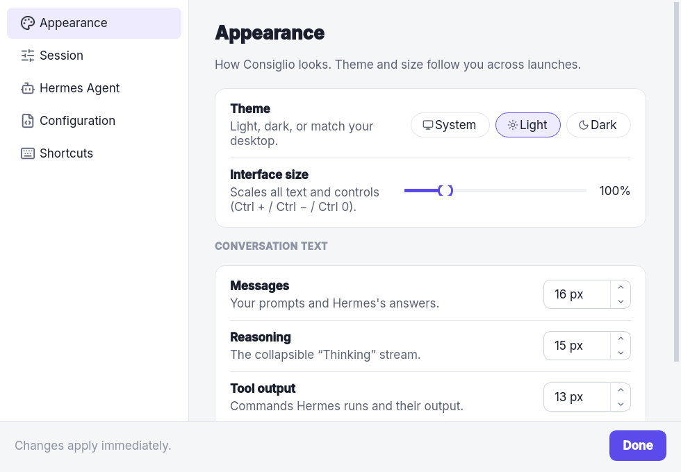
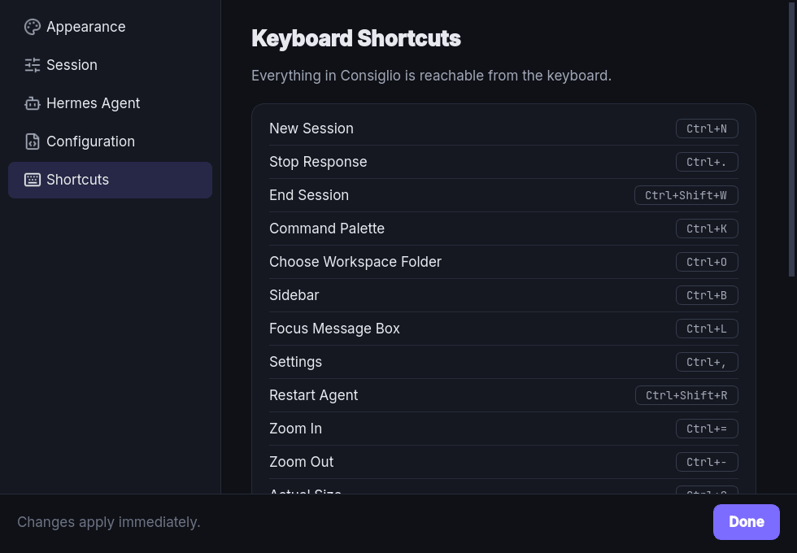
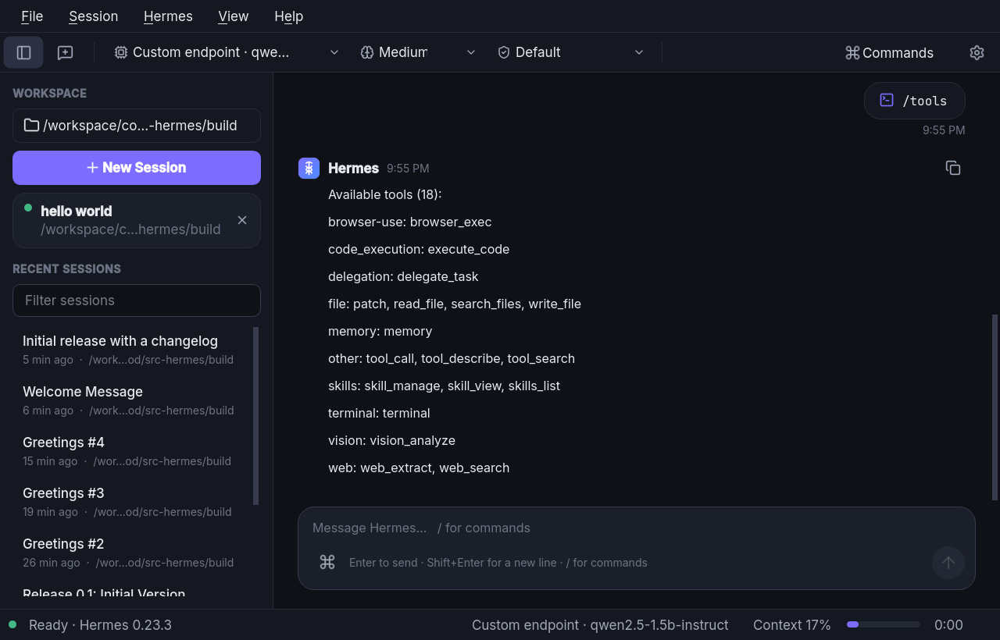
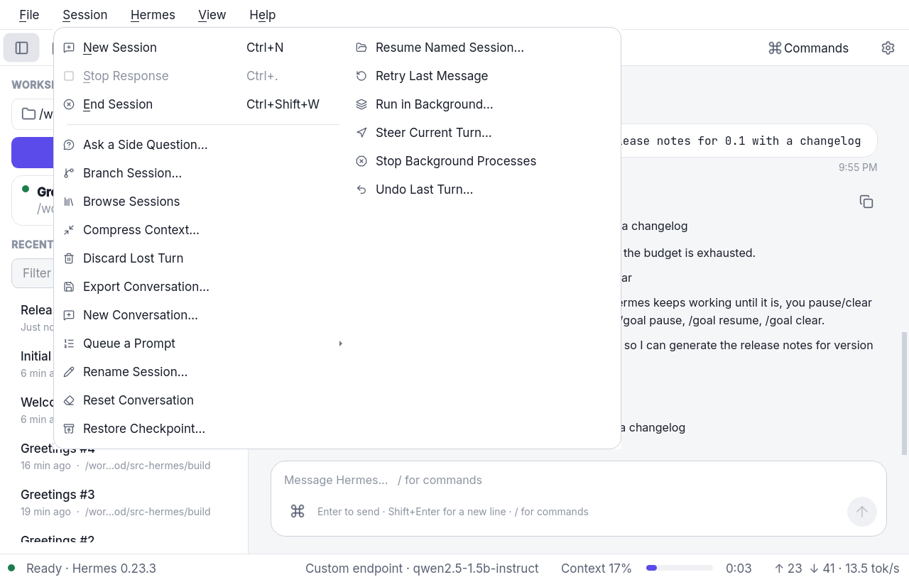

<div align="center">
  
  <h1>Consiglio</h1>
  <p><strong>The desktop workspace for agent sessions that outlive the terminal, built for agents such as Hermes.</strong></p>
  <p>A native client for <a href="https://github.com/NousResearch/hermes-agent">Hermes Agent</a>: every Hermes command in menus and a palette, streamed answers and tool calls, approvals you can see, and saved sessions you can pick up again after restarts and Hermes updates.</p>
  <p>
    
    
    
    
    <a href="https://github.com/rickenator/Consiglio/releases/latest"></a>
  </p>
  <p>
    <a href="#start-here"><strong>Get started</strong></a>
    &nbsp;&middot;&nbsp;
    <a href="src-hermes/README.md">Hermes client guide</a>
    &nbsp;&middot;&nbsp;
    <a href="https://github.com/rickenator/Consiglio/issues">Report an issue</a>
  </p>
</div>


<p align="center">
  
  <br>
  <sub>The native Hermes client (<a href="src-hermes/README.md"><code>src-hermes</code></a>) talking to a real Hermes agent.</sub>
</p>

<table>
  <tr>
    <td width="33%" align="center"><br><sub><b>Chat</b>, light theme</sub></td>
    <td width="33%" align="center"><br><sub><b>Hermes menu</b>: every slash command, grouped</sub></td>
    <td width="33%" align="center"><br><sub><b>Command palette</b> (Ctrl+K)</sub></td>
  </tr>
  <tr>
    <td width="33%" align="center"><br><sub><b>Palette search</b> across Hermes commands</sub></td>
    <td width="33%" align="center"><br><sub><b>Settings</b>: theme and text sizes</sub></td>
    <td width="33%" align="center"><br><sub><b>Keyboard shortcuts</b>, dark theme</sub></td>
  </tr>
</table>

<details>
<summary>More screenshots</summary>
<br>
<table>
  <tr>
    <td width="50%" align="center"><br><sub><b>/tools</b>: what the agent can use</sub></td>
    <td width="50%" align="center"><br><sub><b>Session menu</b>: branch, compress, export, restore</sub></td>
  </tr>
</table>
</details>

---

Consiglio is a desktop workspace for agents such as [Hermes Agent](https://github.com/NousResearch/hermes-agent). Its main client, **Consiglio · Hermes** ([`src-hermes`](src-hermes/README.md)), is a native Qt app. It runs `hermes acp` and talks to it over the Agent Client Protocol. It is built for long-running work rather than throwaway chats: sessions are saved by Hermes and can be resumed, the agent's activity stays visible, approvals are explicit, and a Hermes update doesn't strand you.

## Why Consiglio

Hermes is powerful, but serious work rarely fits into one terminal session. Consiglio adds the desktop layer: one place to start and resume sessions, see what Hermes is doing, answer its approval requests, and change its settings, without memorizing slash commands.

- **Every command, discoverable.** The menus, the command palette (Ctrl+K) and composer completion list every slash command the running Hermes reports, including ones added by an update.
- **No mystery waiting.** Answers, reasoning, tool calls, context use, token counts and turn time stream as they happen.
- **No lost thread.** Saved Hermes sessions are listed in the sidebar and resume where they left off.
- **Approvals you can see.** When Hermes asks before running something dangerous, Consiglio shows exactly what it asked and sends back only an option Hermes offered.
- **Survives updates.** Consiglio never pins a Hermes path or version. If the agent exits, it relaunches it and reopens your session.

> Consiglio is an independent open-source client. Hermes Agent is a separate project by Nous Research. You install it, choose its model provider and update it with Hermes's own tools; Consiglio uses your existing Hermes configuration.

## What It Does

| Surface | Behavior |
| --- | --- |
| **Conversation** | Streams answers, collapsible reasoning, tool calls and their output, with Markdown, tables and code. Every message can be copied. |
| **Sessions** | The sidebar shows the workspace folder, the current session and recent Hermes sessions (filterable). They come from Hermes's own session store. |
| **Commands** | Every Hermes slash command appears in the **Hermes** and **Session** menus, the palette and `/` completion. Commands with fixed choices get submenus; commands that take text open a small form that shows the exact command line. |
| **Session settings** | Model, reasoning effort, approval mode and any other option Hermes reports become toolbar pickers and appear under Settings → Session. |
| **Approvals** | Hermes's permission requests open a dialog. Closing it, stopping, or the agent exiting all answer "cancelled". |
| **Setup and health** | Settings → Hermes Agent finds the executable, runs `hermes doctor`, `hermes status` and `hermes update`, and opens `hermes setup` / `hermes model` in a terminal. Settings → Configuration shows `hermes config show` (API keys are never displayed) and runs `hermes config set`. |
| **Appearance** | Light, dark and system themes, interface zoom, adjustable text sizes, and a keyboard shortcut for every common action. |

## Start Here

### 1. Install Hermes Agent

Use the official installer ([Hermes installation docs](https://hermes-agent.nousresearch.com/docs/getting-started/installation)):

```bash
# Linux, macOS, WSL2
curl -fsSL https://hermes-agent.nousresearch.com/install.sh | bash
```

```powershell
# Windows (PowerShell)
iex (irm https://hermes-agent.nousresearch.com/install.ps1)
```

Then choose a model provider and check the install:

```bash
hermes setup      # full setup wizard (or: hermes model)
hermes doctor
```

Consiglio uses whatever provider and model Hermes is configured with. It was developed and tested against Hermes v0.23.3, and it works out what each newer version supports when it connects.

### 2. Build and run Consiglio · Hermes

The native client needs CMake 3.16+, a C++17 compiler and Qt 5 (Core, Gui, Widgets, Svg, Test). On Debian or Ubuntu:

```bash
sudo apt install build-essential cmake qtbase5-dev libqt5svg5-dev
git clone https://github.com/rickenator/Consiglio.git
cd Consiglio
cmake -S src-hermes -B src-hermes/build
cmake --build src-hermes/build -j
src-hermes/build/ConsiglioHermes
```

On macOS, install `cmake` and `qt@5` with Homebrew and add `-DCMAKE_PREFIX_PATH="$(brew --prefix qt@5)"` to the first `cmake` command. The client is developed and tested on Linux. There are no prebuilt packages of it yet: the [release downloads](https://github.com/rickenator/Consiglio/releases/latest) are the [Electron app](#optional-and-legacy-backends) below. Tests and the screenshot tour are described in [`src-hermes/README.md`](src-hermes/README.md).

### 3. How Consiglio finds Hermes

The executable is looked up every time the agent starts, in this order:

1. a path set in Settings → Hermes Agent, or passed as `--hermes <path>`;
2. `$HERMES_BIN`;
3. `PATH`;
4. the standard install locations: `~/.local/bin`, `~/.hermes/hermes-agent/venv/bin`, `/usr/local/bin`, `/opt/homebrew/bin`, `~/bin`.

So an app opened from a desktop launcher still finds a Hermes installed in `~/.local/bin`, even when its `PATH` is shorter than a terminal's.

### 4. Hermes updates itself

Hermes updates with `hermes update`, or from **Hermes → Check for Updates** in Consiglio. Consiglio never pins a Hermes path or version:

- it negotiates capabilities from each agent's `initialize` response and ignores protocol fields and methods it doesn't know;
- the command list is fetched again from the running Hermes and cached per Hermes version, so new commands appear and removed ones disappear;
- if the agent exits (for example during an update), an in-flight turn is reported as failed rather than replayed, and Consiglio relaunches the agent and reopens the active session. **Hermes → Restart Agent** (Ctrl+Shift+R) does the same on demand, which is how you pick up an update applied while the agent was idle.

Saved sessions live in Hermes's own store (`~/.hermes/state.db`) and survive updates and restarts.

## Everyday Workflow

1. Launch `ConsiglioHermes` and pick a workspace folder (File → Choose Workspace Folder, Ctrl+O).
2. Type a request and press Enter. Shift+Enter adds a newline; `/` completes commands.
3. Watch reasoning, tool calls and the status bar (model, context, timer, tokens) while Hermes works. Stop with Ctrl+.
4. Answer approval dialogs when Hermes asks before running something.
5. Change the model, reasoning or approval mode from the toolbar, or run any command from the Hermes menu or the palette (Ctrl+K).
6. Resume any earlier session from **Recent Sessions**.

| Action | Shortcut |
| --- | --- |
| New session | Ctrl+N |
| Command palette | Ctrl+K |
| Stop response | Ctrl+. |
| End session | Ctrl+Shift+W |
| Choose workspace folder | Ctrl+O |
| Toggle sidebar | Ctrl+B |
| Focus message box | Ctrl+L |
| Settings | Ctrl+, |
| Restart Hermes Agent | Ctrl+Shift+R |
| Zoom in / out / reset | Ctrl+= / Ctrl+- / Ctrl+0 |
| Keyboard shortcuts | Ctrl+/ |

## Architecture

```text
Consiglio
├── src-hermes/                     Consiglio · Hermes: native Qt 5 client for Hermes Agent (primary)
│   ├── src/acpclient.*             ACP client for `hermes acp` (JSON-RPC over stdio)
│   ├── src/commandcatalog.*        slash-command discovery, cached per Hermes version
│   ├── src/hermescli.*             executable resolution, doctor/status/update/config
│   ├── src/mainwindow.* …          menus, palette, chat, sidebar, settings, themes
│   └── tests/                      fake ACP agent, real /commands fixtures, offscreen UI tests
├── src-qt/                         earlier Qt client: one-shot Hermes and other agent sessions
├── src/ (+ bin/consiglio)          Electron app for other CLI agents (legacy, see below)
└── mobile/                         Android/iOS companion for the Electron app
```

Consiglio · Hermes starts `hermes acp` as a child process with an argument list, never through a shell. It talks newline-delimited JSON-RPC over that process's stdin and stdout. It advertises no file-system or terminal capabilities to the agent and answers any agent request it doesn't implement with a JSON-RPC "method not found" error. Hermes runs the tools; Consiglio displays them and relays approvals.

## FAQ

**Do I need Node.js, Python or another agent CLI?** Not for Consiglio · Hermes. You need Hermes Agent, which brings its own runtime, and Qt 5 to build the client. The other agent CLIs are only used by the legacy Electron app.

**Which model does it use?** Whichever one Hermes is configured with (`hermes model`, or the toolbar model picker). Consiglio doesn't store provider keys for Hermes; they stay in Hermes's own `~/.hermes/.env`.

**Does it work after `hermes update`?** Yes. See [Hermes updates itself](#4-hermes-updates-itself).

**A command I just got from an update is missing.** Use **Hermes → Refresh Command List**. If the agent was running during the update, restart it first (Ctrl+Shift+R).

**Nothing happens when I send a prompt.** Check the status bar, then run `hermes doctor` and `hermes status` (both are also under Settings → Hermes Agent). A missing or misconfigured provider is the usual cause: run `hermes setup`.

**Where are the downloads?** The [releases](https://github.com/rickenator/Consiglio/releases/latest) currently contain only the Electron app. Build Consiglio · Hermes from source as shown above.

## Optional And Legacy Backends

> [!NOTE]
> Everything in this section is about the **Electron app** (`src/`, the packages on the releases page) and the earlier **Qt client** (`src-qt/`). These are still in the repository and still work, but they are no longer the primary way to use Consiglio. The Electron app does not run Hermes; it runs the Codex CLI, plus preview adapters for other coding-agent CLIs.

### Qt client with one-shot Hermes (`src-qt`)

`src-qt` (Qt 5 with Network, Concurrent and Sql, plus Python 3) can run Hermes sessions with `hermes chat -q` / `hermes chat --resume <id> -q`, along with Codex, Ollama and remote llama.cpp sessions. One-shot Hermes turns have no approval channel back to Consiglio. Hermes applies its own `approvals.*` policy, which denies dangerous commands in one-shot mode by default. For interactive approvals, use Consiglio · Hermes.

```bash
cmake -S src-qt -B src-qt/build && cmake --build src-qt/build -j && src-qt/build/Consiglio
```

### Electron app (Codex CLI)

The Electron app wraps the Codex CLI: persistent tasks that reconnect at startup, a workspace file browser, encrypted secrets for providers and MCP servers, and a mobile companion.

#### Download

| Platform | Recommended package | Alternative |
| --- | --- | --- |
| Linux x64 | `.deb` for Debian and Ubuntu | AppImage for other distributions |
| Windows x64 | Setup `.exe` | Portable `.exe` |
| macOS Apple Silicon or Intel | `.dmg` | `.zip` |

From the [releases page](https://github.com/rickenator/Consiglio/releases/latest). Every change is type-checked, tested, built and packaged on Linux, Windows and macOS.

Supported platforms: Linux x64 (Debian/Ubuntu `.deb`, or the AppImage elsewhere), Windows 10 or 11 x64, and macOS 12 Monterey or newer on Intel or Apple Silicon.

#### From source

Requires Node.js 22+ and npm:

```bash
npm install
npm run dev:all        # run the app
npm run verify         # typecheck, tests, build
```

`bin/consiglio` is a Linux/macOS launcher that builds the checkout and opens the Electron app (`ln -sf "$PWD/bin/consiglio" ~/bin/consiglio`). A packaged clean install creates a writable `Consiglio Workspace` folder in Documents, or in application data if Documents is protected.

#### Codex and Open Interpreter front ends

- **Finding Codex.** The app searches `CODEX_BIN`, `PATH`, npm's Windows shim directory and common macOS/Linux CLI locations, so it still finds Codex when launched from Finder, Launchpad or the Start menu.
- **Installing missing front ends.** If Codex or Open Interpreter is missing at startup, the app installs it into its own application-data folder on Linux, macOS and Windows. Codex comes from npm (`npm install --prefix …`); Open Interpreter goes into an isolated Python venv. This needs npm, or Python 3.10–3.12, respectively. A valid `CODEX_BIN` or `OI_BIN` you set yourself is kept.
- **Preview adapters.** Aider, Claude Code, Gemini, Copilot and Amazon Q adapters exist in `src/main/adapters/` as preview integrations. See [Release Readiness](docs/RELEASE_READINESS.md).

#### Provider setup

On a clean install, the Electron app checks providers before creating the first task:

1. It prefers running llama.cpp or Ollama servers, including compatible endpoints found on the computer's local IPv4 networks. You confirm a discovered endpoint before any prompt is sent to it.
2. A signed-in Codex CLI can be used for the Codex account route (Codex, GPT-5.6).
3. If nothing usable responds, it shows a first-run setup screen instead of creating a broken conversation.

The conversation header and sidebar always show where prompts are going: provider, model, and endpoint or Codex account route. For remote llama.cpp, give the endpoint (for example `http://192.168.1.50:8081`) and model under **Providers**. The server must support the Responses API shape Codex expects; the placeholder API key `llama.cpp` can be replaced if the server needs authentication.

#### Recovery

Task state is written to the user-data directory as work happens. Conversation and activity history, the Codex thread ID, repository and branch, provider/model/endpoint, creation time and the unsent draft all survive a restart. If shutdown interrupts a response, **Continue task** resumes the same Codex thread. Reconnecting a task reuses its session id, so history, subscriptions and the mobile view stay attached.

#### API keys and MCP

Open **Secrets** to add credentials. Values are encrypted with Electron `safeStorage`, the secrets file is readable only by the current OS user, and saved values are never sent back to the renderer. Provider keys under **Providers** use the same encryption. Storage is refused when Linux offers only the insecure `basic_text` fallback. Each credential can be scoped to all providers, Codex/OpenAI tasks, or local and LAN tasks, and it applies to the next turn.

Reference a saved variable from `~/.codex/config.toml`. The **MCP config** button copies these patterns with the right variable name:

```toml
[mcp_servers.example]            # STDIO
command = "example-mcp"
env_vars = ["EXAMPLE_API_KEY"]

[mcp_servers.example_http]       # Streamable HTTP
url = "https://example.com/mcp"
bearer_token_env_var = "EXAMPLE_API_KEY"
```

Local llama.cpp and LAN sessions use isolated Codex profiles by default, so the normal MCP server list stays out of them. If MCP can't see a key, check three things: the credential is enabled, the server references the exact variable, and the task uses a profile that includes that server. Then reconnect the task.

#### Approvals

Command approval requests show the command and affected paths and route desktop and mobile decisions back to the waiting agent. Codex `exec --json` turns don't emit approval requests.

#### Android and iOS companion

The Capacitor client in [`mobile/`](mobile/) connects to a deliberately narrow bridge hosted by the Electron app. It can view sessions and timelines, send prompts, reconnect or stop tasks, and approve or reject pending commands. It cannot read secrets, change providers, browse arbitrary files or run arbitrary bridge commands. The bridge is off by default and binds only to loopback; put it behind an authenticated HTTPS tunnel or reverse proxy. See [Mobile Companion](docs/MOBILE.md).

#### Packaging and releases

`npm run package:host` builds native packages for the current OS (`package:linux`, `package:win`, `package:mac`). Pushing a version tag that matches `package.json`, or running the **Release Consiglio** workflow, publishes a release only after every platform package passes validation. Each release includes `SHA256SUMS.txt`, an SPDX SBOM and a Sigstore-backed attestation. Signed releases need macOS Developer ID signing and notarization and Windows Authenticode signing. A tag push fails closed without them; a manual run can explicitly opt in to unsigned macOS and Windows packages. See [Releasing Consiglio](docs/RELEASING.md).

#### Electron architecture

```text
src/main.ts                     Electron main process: agent runner, persistence
src/main/adapters/              Codex adapter (used) and preview adapters
src/main/startup-bootstrap.ts   Codex / Open Interpreter installation into user data
src/main/app-protocol.ts        bounded renderer protocol and path validation
src/preload.ts                  narrow contextBridge API
src/App.tsx, src/features/      React UI: task rail, timeline, files, secrets, mobile pairing
```

The renderer never launches commands or reads credentials. The main process owns subprocesses, file access, persistence, provider setup and encryption. Packaged builds serve the UI through a private secure protocol, and Electron fuses disable Run-as-Node, Node option injection, command-line inspection and loading code from outside the ASAR bundle. macOS and Windows also enforce ASAR integrity.

## Design Rule

Consiglio must not become a toy abstraction over the agent. Every visual action should map to something you can inspect: an agent command, a protocol message, a file operation or a setting. Errors stay selectable and copyable, so failures can be debugged from evidence rather than hidden behind generic UI states.

## License

Copyright 2026 Rick Goldberg, Aniviza LLC Productions.

Licensed under the [Apache License 2.0](LICENSE). See [NOTICE](NOTICE) for attribution information.
